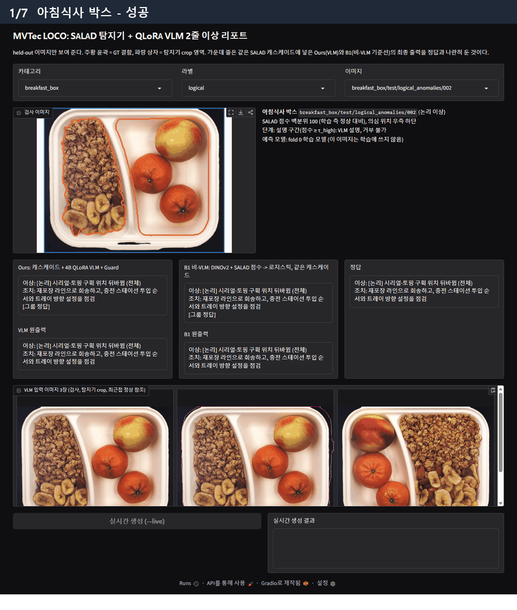
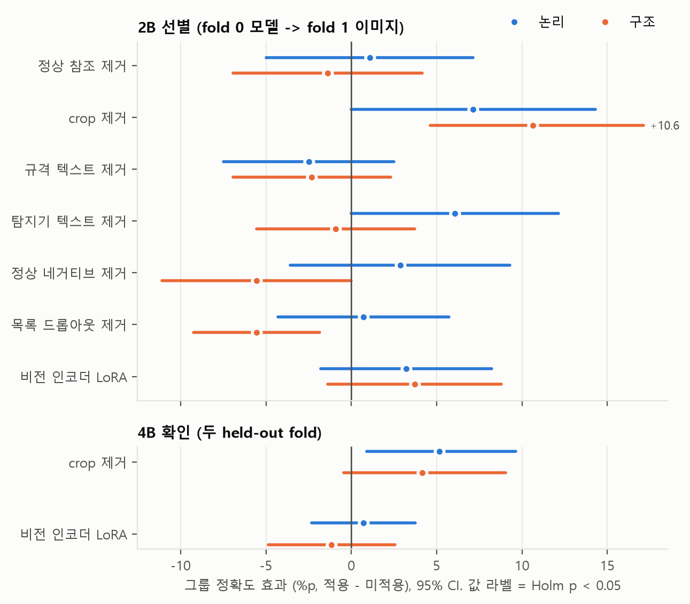
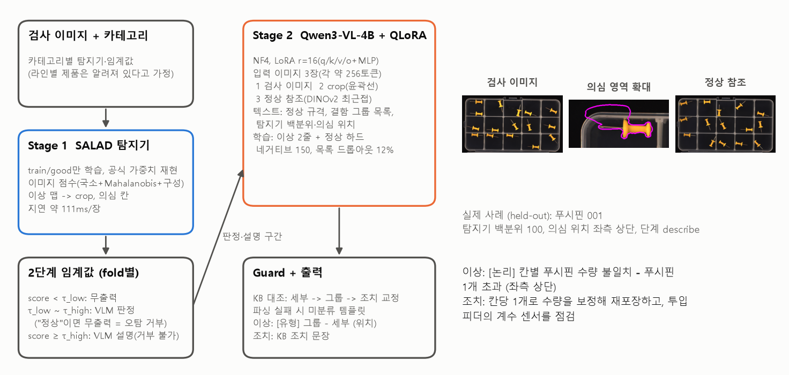
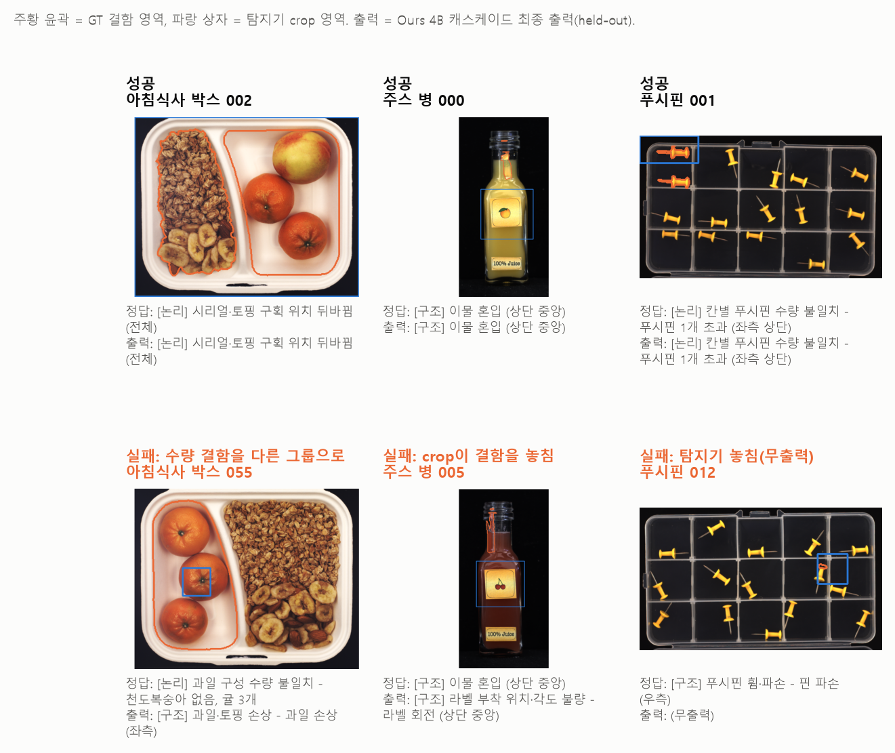

# MVTec LOCO AD: 이상 탐지기 + LoRA 적응 VLM 2줄 이상 리포트

비지도 이상 탐지기(SALAD)가 1차 판정하고, 이상이 의심될 때만 QLoRA로 적응시킨 Qwen3-VL이
고정 템플릿 2줄을 출력한다. 정상이면 아무것도 출력하지 않는다. 로컬 GPU 1장(RTX 3060 12GB)에서 학습·평가했다.

```
이상: [논리] 칸별 푸시핀 수량 불일치 - 푸시핀 1개 초과 (좌측 상단)
조치: 칸당 1개로 수량을 보정해 재포장하고, 투입 피더의 계수 센서를 점검
```

> 진행 상태(2026-10-29): Phase 0, M1·M2(본 실험), M3(분석, 4B 확인과 open-set 포함) 완료. P2(8B, 라벨 수 곡선)를
> 학습 대기열에서 실행 중이고, M4 산출물(표·그림·데모·PDF)은 P2 결과만 남았다. 아래 수치는 모두 `reports/tables/`에서
> 자동 생성된 값이다.



데모 화면(`python -m app.demo`, 캐시 모드). 각 이미지는 그 이미지를 학습하지 않은 fold 모델의 출력이다. 사례는 그림 4와 같은
규칙으로 미리 정한 목록이며 실패 3건(수량 결함을 다른 그룹으로, crop이 결함을 놓침, 탐지기 놓침)을 함께 보여 준다.

## 핵심 결과

두 held-out fold 예측 합산(이상 993장, 정상 575장). 각 이미지는 자기를 학습하지 않은 fold 모델의 예측이다.
설명 지표는 정답 이상 이미지를 모두 넣은 oracle 게이팅, 종단 그룹 F1은 SALAD 캐스케이드를 거친 최종 출력 기준이다.

| 시스템 | 그룹 | 유형 | 세부 | 위치 적중 | 정상 거부 | 종단 그룹 F1 (test 비율 / π=1%) | 생성(초/장) | 최대 VRAM(GB) |
|---|---|---|---|---|---|---|---|---|
| B0 최빈값 | 28.7 | 56.5 | 10.0 | 24.3 | 0.0 | 25.4 / 2.2 | - | - |
| B1 비-VLM (DINOv2 + SALAD 점수 -> 로지스틱) | **67.0** | **76.0** | **61.9** | **70.8** | 86.6 | **68.7 / 19.7** | - | - |
| B2 VLM 단독 (4B QLoRA, 탐지기 없음) | 44.0 | 56.1 | 33.2 | 44.0 | 66.4 | 45.5 / 2.5 | 5.8 | 5.92 |
| B3 4B zero-shot (엄격 파싱) | 6.0 | 5.3 | 0.2 | 0.3 | 0.2 | 5.6 / 0.5 | - | - |
| Ours 2B bf16 LoRA | 43.7 | 64.8 | 27.7 | 66.0 | 82.1 | 44.0 / 9.3 | 2.4 | 7.4 |
| Ours 4B QLoRA (seed 3개 평균) | 55.7 | 71.4 | 44.5 | 69.0 | **86.8** | 55.6 / 10.6 | 6.1 | 6.32 |

전체 표(macro-F1, 형식, 학습 시간 포함): [`reports/tables/table1_main.md`](reports/tables/table1_main.md)

무엇을 보여 주었고 무엇을 보여 주지 못했는가
- **LoRA 적응은 크게 효과가 있다.** 같은 4B 모델의 zero-shot은 형식을 14%만 지키고 그룹 정확도 6.0%였지만
  (그룹 이름만 찾아 교정하는 관대 파싱으로도 29.0%, few-shot 29.2%), QLoRA 후 형식 99.9%, 그룹 55.7%
  (seed 0 기준 엄격 zero-shot 대비 +50.2%p, McNemar p=1e-132). 학습 전후 MMAD 객관식 정확도는 fold별
  56.5 -> 56.6, 56.4 -> 56.1로 망각도 전이도 없었다.
- **그러나 비-VLM 진단기 B1이 더 낫다(RQ1 가설 기각).** 같은 SALAD 점수와 DINOv2 특징을 쓰는 로지스틱 회귀가
  그룹 정확도에서 +10.8%p [7.3, 14.2] 앞서고, 같은 캐스케이드에 넣어도 종단 그룹 F1이 68.7 vs 55.6이다.
  사전 등록한 원칙대로 이 결과를 그대로 보고한다.
- **캐스케이드는 VLM 단독보다 낫다(성공 기준 충족).** 종단 정답 그룹 F1 +10.5%p [7.2, 13.9](seed 3개 모두 같은 결론),
  탐지기 단독 대비 오경보 65% 감소. 다만 재현율을 4.0%p 잃어 RQ4 가설(손실 1%p 이하)은 충족하지 못했고,
  π=1%에서 VLM 호출률은 22.6%로 목표(10%)를 넘는다(탐지기 FPR 21.9%가 원인).
- **격차가 어디서 생기는가.** 개수 계열 결함(과일·푸시핀·부품 수량, 169장)은 Ours 64.3 vs B1 64.5로 같다.
  격차는 칸막이 누락(2.6 vs 100), 케이블 길이(47 vs 100) 같은 장면 전체의 구성 결함과 나사 길이↔부품 수량 혼동에서 나온다.
  오류 분해에서 종단 오류의 79%가 VLM의 그룹 오답이고 탐지기 놓침은 12%다.
- **입력 기여(RQ2).** 이상 영역 crop을 빼면 2B 선별에서 그룹 -8.7%p(구조 결함 -10.6%p, Holm p=0.025), 4B 두 fold
  확인에서도 -4.7%p [-8.0, -1.5](p=0.0049)로 재현됐다. 정상 참조 이미지와 정상 규격 텍스트는 효과가 없었고(가설 미지지),
  2B에서 +3.4%p였던 비전 인코더 LoRA는 4B에서 재현되지 않아(-0.1%p, 정상 거부 -4.9%p) 비전 인코더는 동결했다.
- **미등록 결함(RQ3).** 목록 드롭아웃은 처음 보는 결함에 "미분류"로 답하는 비율을 0%에서 4~8%로 올렸을 뿐 유의하지 않았고
  (p=0.062, 0.25), 대부분은 기존 그룹으로 흡수됐다.

## 연구 질문과 판정 (사전 등록, `reports/tables/m3_summary.md`)

| RQ | 가설 (결과 전 기록) | 결과 | 판정 |
|---|---|---|---|
| RQ1 진단 이득 | 그룹 정확도는 B1과 비슷하고 논리 결함 세부에서 앞선다 | 그룹 -10.8%p, 논리 결함에서도 B1 우세(75.8 vs 63.3) | 기각 |
| RQ2 입력 단서 | 참조·규격은 논리, crop은 작은 구조 결함에 기여 | 2B: crop 구조 +10.6%p(Holm 유의), 참조 0.0, 규격 -2.4. 4B 확인: crop 전체 +4.7%p(p=0.0049, 논리·구조에 고르게 분산), 비전 인코더 LoRA -0.1%p | crop만 지지 |
| RQ3 미등록 결함 | 목록 드롭아웃 없이는 미등록 결함을 기존 그룹으로 오분류 | 미분류 응답 드롭아웃 있음 vs 없음: 이물 혼입 제외 7.9% vs 0%(p=0.062), 논리 그룹 제외 4.1% vs 0%(p=0.25). 기존 그룹 오분류 81.0 vs 88.9, 90.5 vs 95.9 | 방향 일치, 효과 작음 |
| RQ4 거부 단계 | 재현율 손실 1%p 이하로 오경보 절반 이상 감소 | 오경보 -65%, 재현율 -4.0%p | 미충족 |

탐색 관찰(사전 등록 아님): 논리형 open-set에서는 드롭아웃 모델의 알려진 결함 그룹 정확도가 53.3 vs 58.3으로 낮았다
(쌍대 12:33, p=0.0025, 구조형에서는 차이 없음). 미분류 응답을 늘리는 대가로 알려진 결함 정확도를 깎을 수 있다는 가능성으로만 기록한다.

ablation 효과(위: 2B 선별, 아래: 상위 2개의 4B 2-fold 확인, 95% CI, 논리/구조 분리):



## 시스템 구조



- Stage 1 SALAD(ICCV 2025): 공식 가중치로 재현해 5개 카테고리 평균 image AUROC 96.11(보고치 96.1).
  이미지별 점수 3항과 맵을 저장하는 래퍼를 직접 구현하고, 저장값으로 다시 계산한 AUROC가 공식 스크립트 출력과
  같음을 확인했다(차이 0). 지연 약 111ms/장.
- 2단계 임계값(fold별, 학습 측 test 이미지만 사용): τ_low(학습 측 이상 재현율 0.95) 미만은 무출력,
  τ_low~τ_high는 VLM이 정상/이상 판정(오탐 거부), τ_high(정상 FPR 1%) 이상은 VLM 설명(거부 불가).
- Stage 2 Qwen3-VL-4B-Instruct + QLoRA(NF4, r=16, q/k/v/o + MLP), 이미지 3장(검사, 탐지기 crop, DINOv2 최근접 정상 참조,
  각 약 256토큰) + 정상 규격·결함 그룹 목록·탐지기 백분위 텍스트. 정상 하드 네거티브 150장, 목록 드롭아웃 12%, epoch 3 고정.
- Guard: KB와 대조해 세부 -> 그룹 -> 조치 순으로 교정, 파싱 실패 시 미분류 템플릿. 지표는 Guard 전후를 모두 보고한다.

## 출력 명세

```
이상: [<유형>] <그룹명>[ - <세부>[ + <세부>]][ (<위치>)]
조치: <조치>
```

- 유형 `논리 | 구조 | 미상`, 그룹명과 조치는 `taxonomy/action_kb.yaml` 문장을 그대로 쓴다.
- 위치는 세부 결함의 `loc_mode`로 정한다.
  - `point`: 3x3 칸 이름 (GT 마스크를 긴 변 2% 반경으로 closing한 뒤 면적 최대 칸)
  - `global`: `전체` (제품·구획 전체, 부품 사이 관계를 칠한 결함)
  - `instances`: 생략 (같은 종류 부품을 모두 칠해 어느 개체가 결함인지 GT로 알 수 없음)
- 각 줄 60자 이하. `tests/test_output_spec.py`가 모든 KB 조합에서 길이와 파서 왕복을 확인한다.

held-out 성공 3건과 실패 3건(선택 규칙은 `src/report/m4_figures.py` 머리말에 고정):



## 재현 절차

### Phase 0. 데이터 인덱스와 택소노미

```bash
python -m src.data.mask_stats        # 세부 결함별 마스크 통계 + 확인용 시트
python -m src.data.index_loco        # data/index.parquet (3,651장, 위치 라벨·정답 리포트 포함)
python -m src.data.splits            # 1차 분할 (근접 중복 목록이 없으면 그대로)
python -m src.data.near_dups         # DINOv2 임베딩 + 근접 중복 쌍
python -m src.data.splits            # 근접 중복을 같은 fold로 모아 다시 분할 + inner-val
python -m pytest
```

- 데이터: `MVTec-LOCO/`에 MVTec LOCO AD와 MMAD 부가자료(`QA.json` 등)를 둔다.
- 분할: test 1,568장을 (카테고리, 라벨, 결함 그룹) 층화 2-fold로 나누고, fold마다 학습 측 15%를
  inner-val(하이퍼파라미터·프롬프트·임계값 선택 전용)로 뗀다. fold에 2장 이하인 그룹은 inner-val에서 뺀다.
- `loc_mode` 확정 과정: 통계 기반 초안과 시트 확인 결과가 다른 20종은 `data/defect_mask_stats.csv`의
  `draft_loc_mode`와 `kb_loc_mode` 열에 남아 있다.
- 근접 중복: 처음 계획한 "DINOv2 CLS 코사인 0.98 이상"은 쓸 수 없었다. 카메라·배치가 고정된 장면이라
  서로 다른 이미지도 전역 특징이 거의 같다(pushpins는 test 쌍 유사도 중앙값이 0.9835라 3만 쌍 이상이 걸림).
  대신 같은 위치 패치 토큰의 평균 코사인을 쓰고, 카테고리마다 최근접 유사도의 중앙값 + 6 x MAD(정규 환산)를
  임계값으로 둔다. 결과는 핀이 모두 빠진 빈 케이스 5장(pushpins 논리 057~061) 한 묶음이며 같은 fold로 모았다.

### M1. MVP (EfficientAD + Qwen3-VL-2B LoRA, breakfast_box·screw_bag)

모든 학습은 대기열(`configs/run_queue.yaml`)에 넣고 감독자가 실행한다. Claude Code나 터미널의 자식 프로세스로
직접 띄우지 않는다.

```bash
python -m src.vlm.build_sft --fold 0 --categories breakfast_box screw_bag --crop-source gt --name m1_gt
python -m ops.smoke m1_vlm2b_f0
```

```powershell
.\ops\env.ps1 -Action setup
```

대기열 순서: EfficientAD 학습·탐지 캐시 내보내기(카테고리별) -> 탐지기 crop으로 SFT 데이터 재생성 ->
2B LoRA 학습(시간·VRAM 실측, inner-val 생성 평가) -> 4B QLoRA 30 step 실측 -> 종단 실행(`src.pipeline`).
결과 표는 `python -m src.report.tables m1`, 그림은 `python -m src.report.figures ...`로 다시 만든다.

### M2. 본 실험 (SALAD 캐시 동결, 5개 카테고리 2-fold)

SALAD는 `imgaug`(numpy 2 비호환) 때문에 별도 가상환경에서 공식 사전학습 가중치로 점수만 추출한다.

```bash
python -m venv E:\venvs\loco_salad
E:\venvs\loco_salad\Scripts\python.exe -m pip install torch==2.5.1 torchvision==0.20.1 --index-url https://download.pytorch.org/whl/cu124
E:\venvs\loco_salad\Scripts\python.exe -m pip install numpy==1.26.4 opencv-python==4.10.0.84 scikit-learn scipy timm "positional-encodings[pytorch]" imgaug "pandas<3" tqdm pillow gdown
```

- 배포 가중치 점검: `E:\venvs\loco_salad\Scripts\python.exe -m src.detector.fix_salad_weights`.
  공식 `salad_loco.zip`의 `breakfast_box/autoencoder_final.pth`에는 다른 가중치 파일 24개가 같은 zip 안에 덧붙어
  있어(1.2GB) `torch.load`가 실패한다. 모델 기록만 남겨 다시 묶으면 정상 로드된다(CRC 정상, 다른 카테고리와 같은 구조).
- `src/detector/salad_runner.py`: 공식 `test()`와 같은 프로세스·정규화 값으로 이미지별 점수 3항(국소 맵 최댓값,
  Mahalanobis, 합성 맵 최댓값)과 맵을 저장하고, 저장값으로 다시 계산한 AUROC 4종이 공식 출력과 같은지 확인한다.
- SFT: `build_sft --crop-source salad --hard-neg 150` (정상 하드 네거티브 = 학습 측 정상 중 탐지 점수 상위).
  입력 ablation은 `--drop-image ref|crop`.
- 학습: 4B QLoRA 2 fold x seed 3, 2B LoRA 2 fold, ablation(2B, fold 0), epoch 3 고정. 학습 후 held-out 예측을 한 번 저장.
- 기준선: B0 최빈값(`src.baselines.majority`), B1 비-VLM 진단기(`src.baselines.crop_classifier`),
  B3 프롬프트만 쓰는 VLM(`src.baselines.vlm_prompt`, zero/few-shot, 엄격·관대 파싱).
- MMAD 객관식(학습 전후, 전이·망각): `src.eval.mmad_eval`.
- 집계: `python -m src.report.m2_report` -> `reports/tables/m2_summary.md`.

### M3. 분석 (P1 ablation, open-set, B2, 캐스케이드, 실패 분석)

- 대기열: 2B fold 0 ablation 5종(정상 네거티브, 규격 텍스트, 탐지기 텍스트, 목록 드롭아웃 제거, 비전 인코더 LoRA),
  4B open-set 4종(이물 혼입 제외 / 카테고리별 논리 그룹 1개 제외, 각각 드롭아웃 유무, `build_sft --exclude-groups`),
  B2 VLM 단독(`build_sft --crop-source none`), 효과 상위 2개(crop, 비전 인코더 LoRA)의 4B 2-fold 확인.
- 집계(대기열 마지막 작업이 자동 실행):

```bash
python -m src.eval.cascade            # RQ4, 종단 F1(Ours vs B2, π 보정, 층화 paired bootstrap), 오류 분해
python -m src.eval.failure            # 결함 종류·해상도·crop 포함률·참조 유사도별 분해, 사례 후보
python -m src.report.m3_report --with-figures
```

### P2. 추가 실험 (결과 전 가설 등록 후 실행 중)

- 모델 크기: Qwen3-VL-8B QLoRA, 4B 주력과 같은 설정, 2 fold.
- 라벨 수 곡선: `build_sft --label-frac 0.25|0.5`(학습 측을 역할·카테고리·그룹 층별로 줄임, 층마다 최소 1장,
  25 ⊂ 50 ⊂ 100 중첩). 2B LoRA와 B1을 같은 부분집합으로 학습해 비교한다.
- 집계: `python -m src.report.p2_report` -> `reports/tables/p2_summary.md`, `reports/figures/label_curve.png`.

### M4. 산출물

```bash
python -m src.report.m4_tables        # 표1 reports/tables/table1_main.md
python -m src.report.m4_figures       # 그림1 system.png, 그림4 cases.png
python -m src.report.figures pi_curve --pipeline reports/tables/m3_cascade_pi.summary.json   # 그림2
python -m src.report.figures ablation # 그림3
python -m app.demo                    # Gradio 데모 (held-out 갤러리 + 캐시, GPU 불필요, ?id=<image_id>로 바로 열기)
python -m app.demo --live             # 4B QLoRA 어댑터로 실시간 생성
python -m app.record_gif              # 데모 GIF reports/figures/demo.gif (Edge 헤드리스 + CDP, 새 설치 없음)
python -m src.report.build_portfolio  # PDF reports/portfolio.pdf (Edge 헤드리스 인쇄, 4쪽 초과 시 실패)
```

## 학습 운영 (GPU 유휴 방지)

| 파일 | 역할 |
|---|---|
| `ops/supervisor.py` | 대기열 실행, 종료 코드·하트비트 감시, 오류 서명 기반 재시도(같은 오류 2회면 failed 후 다음 run), 재시작 시 실행 중 학습 이어받기, 완료 시 자동 원복 |
| `ops/train_hooks.py` | 학습 스크립트 공용: 진행률·하트비트, 원자적 체크포인트 + 완료 표식, NaN 감지, 손상 체크포인트를 건너뛰는 재개, 고장 주입 |
| `ops/monitor.py` | 모니터 창(진행 막대, GPU, 하트비트 경과, 최근 이벤트). 닫아도 학습은 계속되며 `ops\open_monitor.cmd`로 다시 연다. 실행 중인 run의 비고 칸 "직전 시도 오류"는 지금 오류가 아니라 이전 시도의 실패 이유다 |
| `ops/smoke.py` | 대기열에 넣을 때 20 step + 저장·재개 1회 스모크 관문 |
| `ops/envctl.py`, `ops/env.ps1` | 예약 작업 `\LOCO-Train\Supervisor` 등록·해제, 사전·사후 스냅샷, journal, 원복 검증 |
| `ops/fault_drill.py` | 고장 주입 시험 F1~F9 구동과 판정 (`reports/ops/fault_tests.md`) |

- 영구 변경은 예약 작업 1개뿐이다(로그온 시 + 10분마다, 대화형 로그온, 암호 저장 없음, 실행 시간 제한 해제).
- 모든 run이 done이고 결과 검증을 통과하면 자동 원복한다: 예약 작업 해제, done run의 중간 체크포인트 삭제,
  이벤트 로그 보관(`reports/ops/`), `ops/runtime/` 삭제, 사전 스냅샷과 비교(`reports/ops/teardown_report.md`).
- 수동: `.\ops\env.ps1 -Action teardown`(즉시 원복), `-Action verify`(잔여 변경 확인),
  `ops/runtime/PAUSE` 파일을 만들면 실행 중인 run을 멈추고 새 run을 시작하지 않는다.
- 운영 기록: M1·M2 대기열 43시간(37 run) 동안 유휴 6.1분, 재시도 4회, 하트비트 정지 0회. 고장 주입 시험 F1~F7·F9 통과,
  F8(재부팅)은 Smart App Control의 일회성 DLL 차단 때문에 조건부 통과 후 부팅 대기 시간을 추가했다.
- 대기열 명령은 `tests/test_ops.py`가 실제 argparse로 검사한다(YAML 흐름 시퀀스 안의 쉼표가 인자를 쪼개
  데이터 생성이 실패한 M3 사건 이후 추가).

환경 메모 (Windows, torch 2.5.1)
- torch를 먼저 불러온 뒤 `pyarrow.dataset`을 불러오면 DLL 충돌로 traceback 없이 접근 위반으로 죽는다.
  `src/__init__.py`에서 pyarrow를 먼저 불러온다.
- transformers는 torch 2.6 미만에서 체크포인트의 `torch.load`를 막는다(CVE-2025-32434). 재개 시 같은 run의
  출력 폴더 안 파일에 한해 해당 호출 동안만 허용한다(`src/vlm/train_lora.py`의 `trusted_checkpoint`).

## 데이터 사용 규칙

- MMAD QA: `annotation: false` 문항은 제외한다. `summary.json`은 test 전체를 요약한 것이라 쓰지 않는다(누수).
  MMAD는 학습에 쓰지 않고 학습 전후 객관식 정확도(전이·망각) 측정에만 쓴다.
- held-out fold는 최종 1회만 평가한다. 설정 선택은 inner-val로만 하고, epoch는 3으로 미리 고정했다.
- 임계값은 학습 측 test 이미지로만 정한다. validation/good은 SALAD 정규화에 쓰여 점수가 in-sample이라 제외한다.
- 조치 KB(`taxonomy/action_kb.yaml`)는 포트폴리오용 **가상 SOP**이며 실제 현장 절차가 아니다.

## 관련 연구와 차별점

- LogicAD(AAAI 2025, 보고 AUROC 86.0), LogicQA(2025, 87.6), LogSAD(CVPR 2025)는 VLM으로 LOCO 논리 이상 탐지를 다뤘지만
  전용 탐지기 SALAD(96.1)보다 낮다(실험 설정은 다름). 그래서 VLM을 탐지기가 아니라 탐지 뒤의 진단기로 두었다.
- 정상 참조 비교는 AD-Copilot과, 탐지기 맵을 LMM 입력으로 쓰는 구조는 Myriad와 겹친다. 논리 이상 중심이라는 점은 차별점이 아니다.
- 이 프로젝트의 초점: 상용 대형 모델의 무학습 설명이 아니라 로컬 4B QLoRA로 세부 결함 89종을 구조화된 2줄로 출력하고,
  비-VLM 기준선·VLM 단독·입력 ablation과 쌍대 통계로 정량 비교한다. 이상 비율(π) 보정 비용 분석을 더했다.

## 한계

- 비-VLM 진단기(B1)가 그룹·세부·종단 지표 모두에서 앞선다. 이 데이터 규모(fold당 학습 이상 약 420장)에서는
  SALAD의 구성 점수를 직접 쓰는 단순 분류기가 더 강하다. P2(모델 크기, 라벨 수)는 그 원인을 확인하기 위한 실험이다.
- 결함 그룹 36개 중 여럿이 10장 미만이고 세부 결함 89종 중 19종은 한 fold에 1장 이하다. macro-F1은 10장 이상 그룹만 쓴다.
- fold 2개라 fold 간 분산을 보고하지 않는다. 4B는 seed 3개로 학습 변동(그룹 55.4~56.2)을 보였다.
- 공개 데이터셋이라 사전학습 노출 가능성이 있다. 무학습 출력에 영문 결함명이 나온 비율은 0%였지만,
  한국어 출력을 요구한 프롬프트라 노출이 없다는 증거로는 약하다.
- 위치는 `point` 결함만 채점하고, 수량 초과 계열은 GT 특성상 위치를 출력하지 않는다.
- 조치 문장은 가상 SOP다.

## 외부 코드

`external/`에 복제해 쓰며 저장소에는 포함하지 않는다.

| 이름 | 복제 명령 | 커밋 |
|---|---|---|
| SALAD (ICCV 2025, MIT) | `git clone https://github.com/MaticFuc/SALAD.git external/SALAD` | `753ba942025d2644c494a18c1fb4b60ae15332d5` |
| CSAD (대체 탐지기 후보) | `git clone https://github.com/Tokichan/CSAD.git external/CSAD` | `d46cf856b99bf056088b5f510fd984e04813583a` |

## 라이선스

- MVTec LOCO AD: CC BY-NC-SA 4.0 (비상업, 동일 조건). 데이터셋 자체는 재배포하지 않는다.
  `reports/figures/system.png`, `cases.png`, `demo.gif`와 데모 화면에는 데이터셋 이미지 일부가 들어 있어 같은 조건
  (출처: MVTec LOCO AD, Bergmann et al., IJCV 2022)을 따른다.
- MMAD 부가자료: 라이선스 미표기라 재배포하지 않고 인용만 한다.
- Qwen3-VL: Apache-2.0. SALAD: MIT.
- LoRA 어댑터: 비상업 데이터로 학습했으므로 공개할 경우 비상업 조건을 함께 명시한다.

## 확장 방향

의료 영상(예: 내시경·병리 이미지의 이상 소견)에도 같은 구조를 적용할 수 있다. 정상 데이터만으로 학습하는 탐지기가
의심 영역을 고르고, 소량의 판독문으로 적응시킨 VLM이 고정 서식의 소견과 권고를 내며, 그 서식을 KB와 대조하는 Guard를
둔다. 다만 의료에서는 오경보 거부보다 놓침 비용이 훨씬 크므로 τ_low를 더 보수적으로 두고, 이번 실험에서 본
"단순 분류기가 더 강할 수 있다"는 점을 기준선 비교로 먼저 확인해야 한다.
